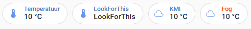

The heading badge only has three elements but can show key information in very little space. As standard however it allows little customisation, we can override `name`, choose an `icon` and choose the icon `color`. We cannot change the state and we cannot use templates. In this guide we will show how to add templating capability to all three elements (icon, name and state).

The badges below show the current temperature as reported by a weather service, the first one is a standard badge.



UIX can forge `name` and `icon` and add template capability to both, but not the state because the badge has no entry key for the state. We can get around this limitation by using the search spark, which can look for a specific text and change it into a different text (which can be a template). For this to work the state needs to be a fixed string so the search spark knows what to look for. The only way to achieve this is by setting `state_content: name` and setting this to a fixed string `name: LookForThis`. Take a look at the second badge to see what this achieves.

Now we can add two sparks to change both the state and the name to something else, in this example:
- The state shows the current temperature, unless current wind speed is 40 or higher, in which case we show wind speed
- We show the (abbreviated) name of the weather institute, unless it issued a warning for severe weather, in which case we show the warning 



```YAML
type: custom:uix-forge
forge:
  mold: badge
  sparks:
    - type: search
      for: hui-entity-badge $
      query: state-display
      actions:
        replace_text:
          find: LookForThis
          replace: >
            
                        
                {{ states('sensor.tulpenlaan_current_temperature', with_unit=true) }}
              
                {{ states('sensor.tulpenlaan_current_wind_speed') | float(0) | round(0) ~ ' kph'}}
              
            
              {{ ' °C' }}      
            
    - type: search
      for: hui-entity-badge $ ha-badge $
      query: span.label
      actions:
        replace_text:
          find: LookForThis
          replace: >
            
              {{ 'KMI' }}       {{
            warnings[0:9] }} 
element:
  type: entity
  entity: sensor.tulpenlaan_current_temperature
  state_content: name
  show_name: true
  name: LookForThis
```



{% include admonition.html type="tip" title="DOM navigation" body="To learn more on how to find where the spark should search refer see <a href='https%3A%2F%2Fuix.lf.technology%2Fconcepts%2Fdom%2F%23uix_style_path0-specific-helper'>UIX Docuemntation</a>" %}

Next, we will dynamically change the icon based on the current weather (this requires a template sensor which gets its data from your favourite weather integration using `action: weather.get_forecasts`). This does not require a spark, we can template `icon` directly and add the following



```YAML
  icon: |-
    
    
    
    {{ 'local:material-symbols-light--cloud-outline-rounded' }}
    
    {{ 'local:material-symbols-light--partly-cloudy-day-outline-rounded' }}
    
    {{ 'local:material-symbols-light--partly-cloudy-night-outline-rounded' }}
    
    {{ 'local:material-symbols-light--wb-sunny-outline-rounded' }}
    
    {{ 'local:material-symbols-light--rainy-light-outline-rounded' }}
    
    {{ 'local:material-symbols-light--rainy-outline-rounded' }}
    
    {{ 'local:material-symbols-light--rainy-heavy-outline-rounded' }}
    
    {{ 'local:material-symbols-light--moon-stars-outline-rounded' }}
    
    {{ 'local:material-symbols-light--sunny-snowing-outline-rounded' }}
    
    {{ 'local:material-symbols-light--weather-snowy-outline-rounded' }}
    
    {{ 'local:material-symbols-light--mist-outline-rounded' }}
    
    {{ 'local:material-symbols-light--weather-hail-outline-rounded' }}
    
    {{ 'local:material-symbols-light--thunderstorm-outline-rounded' }}
    
    {{ 'local:material-symbols-light--thunderstorm-outline-rounded' }}
    
    {{ 'local:material-symbols-light--weather-snowy-outline-rounded' }}
    
    {{ 'local:material-symbols-light--air-outline-rounded' }}
    
    {{ 'local:material-symbols-light--air-outline-rounded' }}
    
    {{ 'local:material-symbols-light--cyclone-outline-rounded' }}
    
    {{ 'local:material-symbols-light--partly-cloudy-day-outline-rounded' }}
    
```





With this the badge looks like the third one above, and all three elements change dynamically. To get to the fourth, which changes the text color for warnings to orangered, we need to add one more thing



```YAML
  uix:
    style:
      ha-badge $: >

        
          .label, slot[name="name"] {
            color: orangered !important;
          }
        
```


